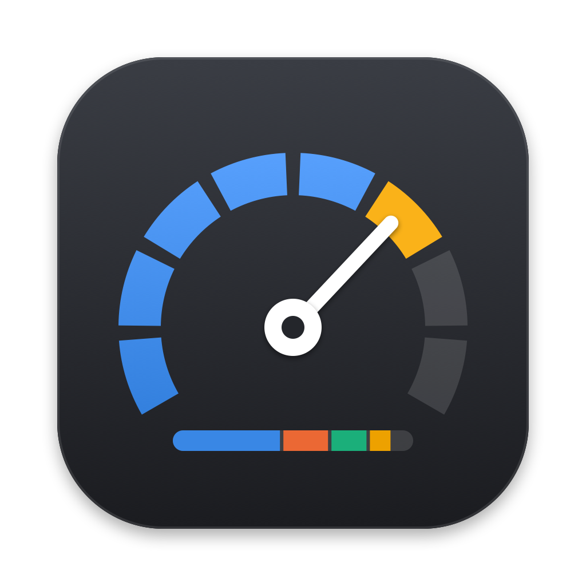
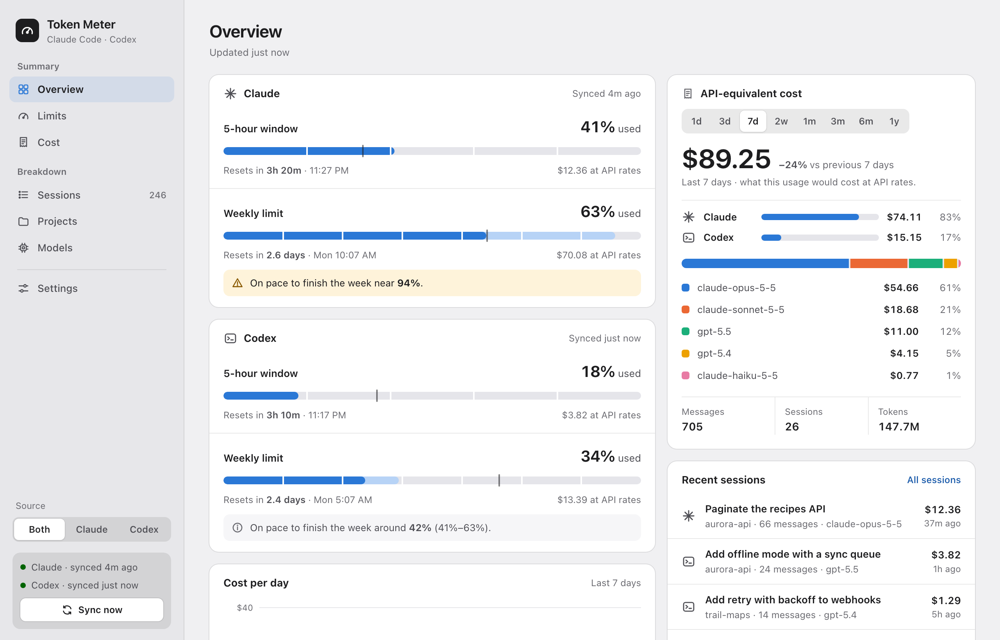
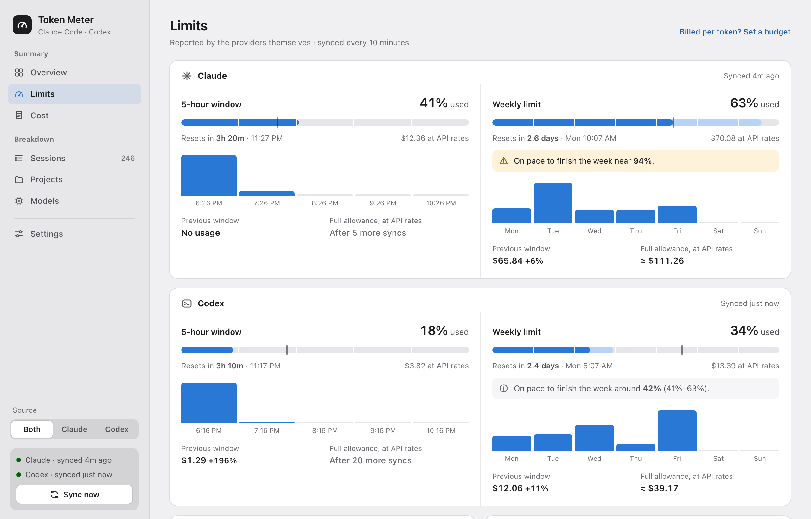
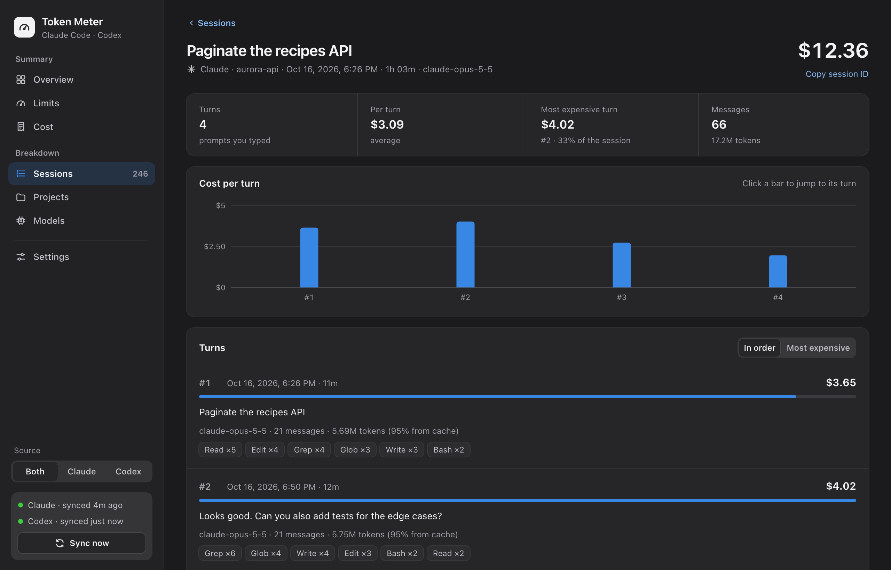
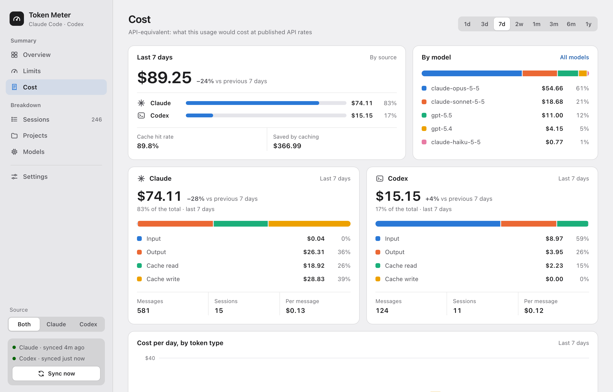
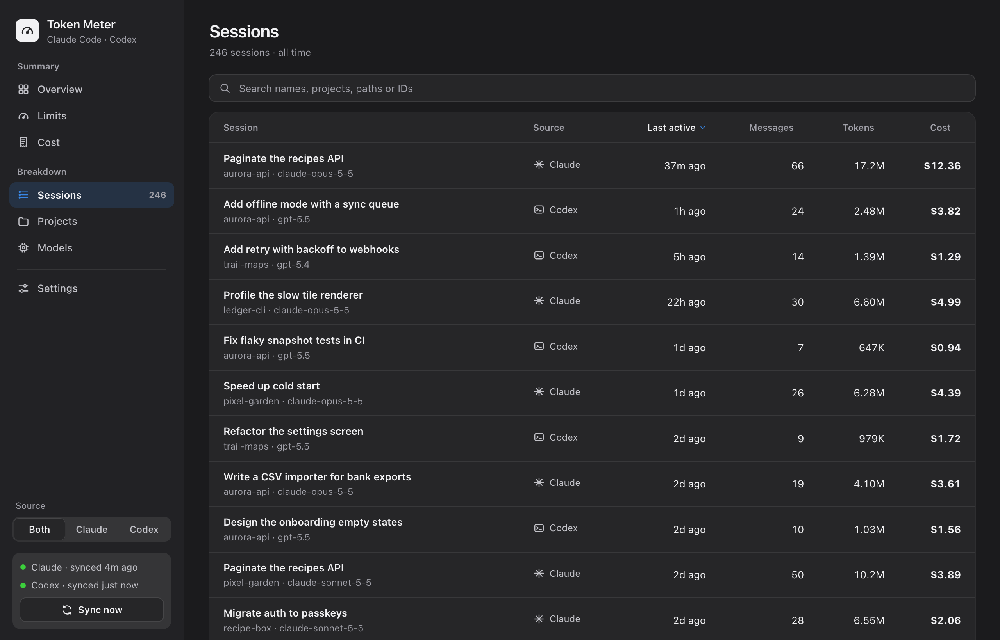

<div align="center">



# Token Meter

**Your Claude Code and Codex limits in the menu bar, plus the API bill you're not paying.** 🧾

<a href="https://github.com/avaakash/ai-token-meter/releases/latest/download/TokenMeter.dmg"></a>

[**Website**](https://avaakash.github.io/ai-token-meter/) · [Releases](https://github.com/avaakash/ai-token-meter/releases) · [Build from source](#-build-from-source)




</div>

> *"How much would this have cost me if I were paying per token?"*
> — you, on a subscription plan, out of pure morbid curiosity

Token Meter is a tiny native Mac app that reads the session logs Claude Code
and Codex already write on your machine. It tells you two things: **how close
you are to your rate limits** (the real percentages, straight from the
providers) and **what all that work would have cost at API prices**. It's the
receipt you'll never get. ✨

Everything stays on your Mac. 🔒 No account, no telemetry, no server.

---

## ✨ What it does

| | |
|---|---|
| 📊 **Limits in the menu bar** | `5h 41% · W 63%`, always visible. It turns orange at 75% and red at 90%, so you see the wall before you hit it. Click it for both sources and their reset times. |
| 🔮 **Run-out forecast** | "On pace to finish the week near 94%." Projected from the shape of your own past weeks, with a range, not a straight line. |
| 💸 **API-equivalent cost** | What your usage would cost per token, for any period from 1 day to 1 year, split between Claude and Codex and broken down by model. |
| 🧵 **Session transcripts** | Open any session to see each prompt you typed, what it cost, the tools the agent used, and a cost-per-turn chart. Click a bar to jump to its turn. |
| 🏷️ **Real session names** | Uses the names from the Claude app and Codex, your renames first. No more staring at UUIDs. |
| 🔥 **Activity** | A year-long heatmap, your streaks, and which hours of the week you burn the most tokens. |
| 🗂️ **Projects and models** | Where the spend goes, per repo and per model. |
| ⚙️ **Your prices, your budgets** | Edit any model's price or add new ones, and reset to the built-in list anytime. Billed per token? Set daily, weekly or monthly budgets and track them like plan limits. |
| 🌗 **Feels like a Mac app** | Sidebar vibrancy, your accent colour, Light/Dark and Increase Contrast, all applied live. |

<table>
<tr>
<td width="50%"></td>
<td width="50%"></td>
</tr>
<tr>
<td align="center"><sub>⏱️ Limits, with the weekly forecast</sub></td>
<td align="center"><sub>🧵 A session, turn by turn (Dark mode)</sub></td>
</tr>
<tr>
<td width="50%"></td>
<td width="50%"></td>
</tr>
<tr>
<td align="center"><sub>💸 Cost over any period</sub></td>
<td align="center"><sub>🗂️ Every session, searchable</sub></td>
</tr>
</table>

<sub>Screenshots use made-up data from <code>scripts/demo-data.py</code>.</sub>

## 📦 Install

1. **[Download `TokenMeter.dmg`](https://github.com/avaakash/ai-token-meter/releases/latest/download/TokenMeter.dmg)** from the latest release.
2. Open it and drag **Token Meter** into **Applications**.
3. Open Token Meter. Look for the gauge in your menu bar. 🎉

> [!NOTE]
> **First launch:** Token Meter isn't notarized by Apple yet, so macOS says it
> can't verify the app. Click **Done**, open **System Settings → Privacy &
> Security**, scroll down and click **Open Anyway**. You only do this once.
> Prefer not to? [Build it yourself](#-build-from-source) in about a minute.

The first time it reads your Claude limits, macOS may ask whether `security`
can use the **"Claude Code-credentials"** Keychain item. That's Claude Code's own
login, read with macOS's built-in `security` tool. Choose **Always Allow** and it
won't ask again.

Homebrew is coming later. 🍺

### Requirements

- macOS 13 Ventura or later, on Apple Silicon or Intel
- [Claude Code](https://claude.com/claude-code) and/or [Codex](https://github.com/openai/codex), used on this Mac

## 🛠️ Build from source

You only need the Xcode Command Line Tools (`xcode-select --install`). No Xcode,
no Apple Developer account.

```sh
git clone https://github.com/avaakash/ai-token-meter.git
cd ai-token-meter
./build.sh --install
```

That builds a universal `Token Meter.app`, copies it to `~/Applications` and
launches it. Gatekeeper doesn't get involved with apps you build yourself.

| Option | |
|---|---|
| `--native` | Build for this Mac's architecture only (faster) |
| `--dmg` | Also package `build/TokenMeter.dmg` |
| `--install` | Copy to `~/Applications` (or `$INSTALL_DIR`) and launch |
| `--import-db PATH` | Bring over history from the [old Python dashboard](legacy-python/) |

## 🧠 How it works

```
~/.claude/projects/**/*.jsonl   ─┐
~/.codex/sessions/**/*.jsonl    ─┼─▶  local SQLite  ─▶  menu bar + dashboard
Claude & Codex limit APIs       ─┘    (Application Support/TokenMeter)
```

- **Cost** comes from the token counts in your logs, priced with
  [`pricing_claude.json`](macpapp/Resources/pricing_claude.json) and
  [`pricing_codex.json`](macpapp/Resources/pricing_codex.json), including cache reads and writes.
  Only new lines are read on each sync, so it stays fast with years of history.
- **Limits** are the percentages the providers report. Claude's are read with
  the OAuth token Claude Code keeps in your Keychain. Codex's come from
  `codex app-server`. Both sync every 10 minutes, or whenever you click **Sync now**.
- The dashboard is a web page inside a native window, served from the app
  bundle over an `app://` scheme. No port is opened.

## ❓ FAQ

<details>
<summary><b>Am I being charged these amounts?</b></summary>

No. On a Claude Pro or Max plan, or ChatGPT Plus or Pro, the dollar figures
are hypothetical: what the same tokens would cost on the pay-per-token API.
</details>

<details>
<summary><b>Does anything leave my Mac?</b></summary>

Only the two limit checks, which go to Anthropic and to OpenAI (through the
`codex` CLI) using the logins you already have. Your logs, prompts and costs
never leave the machine. There's no analytics.
</details>

<details>
<summary><b>Why does it need my Keychain?</b></summary>

To read Claude's live limit percentage, Token Meter uses the token Claude Code
stored there when you logged in. Deny it and everything else still works; the
Claude limit cards fall back to estimates.
</details>

<details>
<summary><b>Why not the Mac App Store?</b></summary>

The App Store sandbox would block reading `~/.claude`, the Keychain item and
the `codex` binary, which is the whole app.
</details>

<details>
<summary><b>The prices look off.</b></summary>

Open **Settings → API prices** and change any model's price. All your past usage
is repriced right away. **Reset** puts back the built-in price for one model, or
for every model at once, and you can add models the built-in list doesn't have yet.
Pull requests that update the built-in prices are welcome.
</details>

<details>
<summary><b>I pay per token, not for a plan.</b></summary>

Set your own limits in **Settings → Budgets**: a daily, weekly (from Monday) or
monthly dollar amount for Claude, Codex or both. They show up on Limits and in
the menu bar like plan limits, turning orange at 75% and red at 90%.
</details>

<details>
<summary><b>How do I uninstall it?</b></summary>

Quit it from the menu bar, then delete `Token Meter.app` and
`~/Library/Application Support/TokenMeter`.
</details>

## 🧑‍💻 Development

```sh
swift run --package-path macpapp usage-core-checks     # core logic checks
./scripts/screenshots.sh                               # regenerate screenshots from fake data
swift scripts/make-icon.swift                          # redraw the app icon
```

To work on the UI in a browser against made-up data:

```sh
python3 scripts/demo-data.py /tmp/token-meter-demo    # prints the serve command
```

| Path | What's there |
|---|---|
| `macpapp/Sources/UsageCore/` | Log scanning, pricing, limits, forecasts (Swift) |
| `macpapp/Sources/TokenMeter/` | Menu bar app and window |
| `macpapp/Resources/web/index.html` | The dashboard UI |
| `macpapp/Sources/usage-cli/` | The backend without the UI, for debugging |
| `docs/` | The [website](https://avaakash.github.io/ai-token-meter/) |
| `legacy-python/` | The original browser dashboard (retired) |

Releases are built by GitHub Actions, by hand: **Actions → Release → Run
workflow** on `main`, with a version such as `1.2.0`.
[`release.yml`](.github/workflows/release.yml) runs the checks, builds the
universal DMG, verifies it, tags `v1.2.0` and publishes a release with the DMG,
its SHA-256 and generated notes.

## 🐍 The old Python dashboard

Token Meter started as a Python script serving a page on `localhost`. That
version lives on in [`legacy-python/`](legacy-python/). It still works and it's
the only one that runs on Linux, but it's no longer developed.

---

<div align="center">
<sub>Not affiliated with Anthropic or OpenAI. Claude and Codex are trademarks of their owners.<br>Made with way too many tokens. 🪙</sub>
</div>
